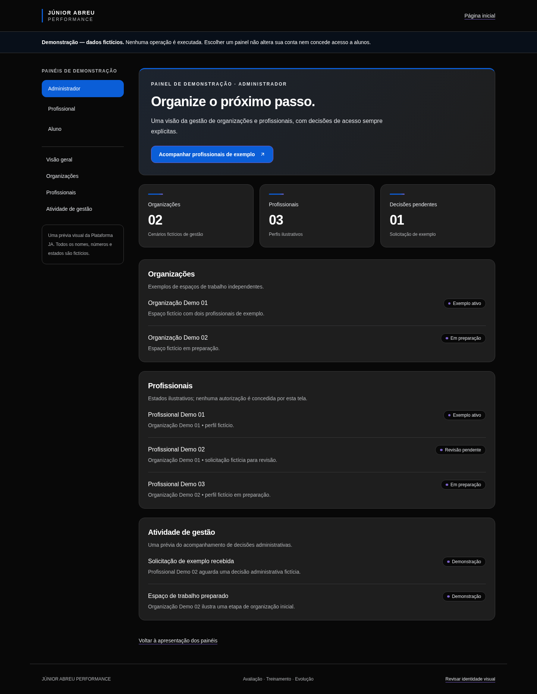
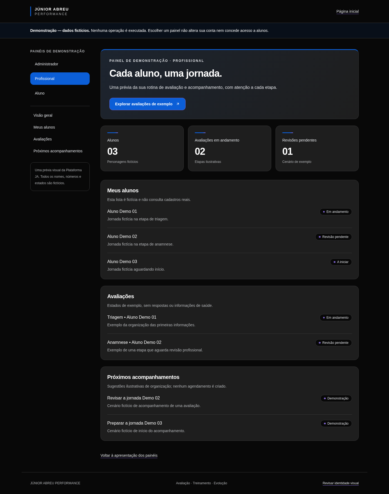
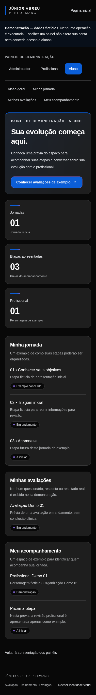
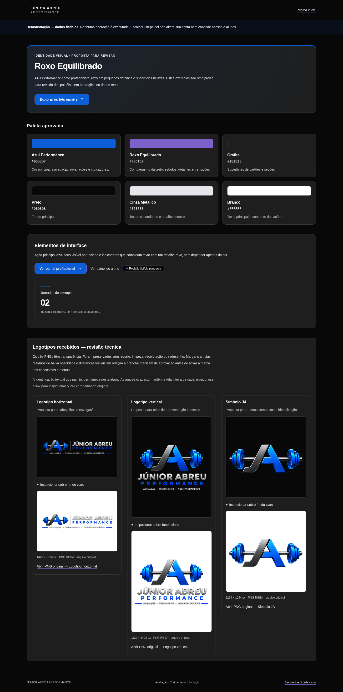
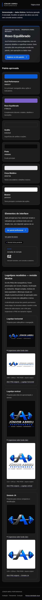
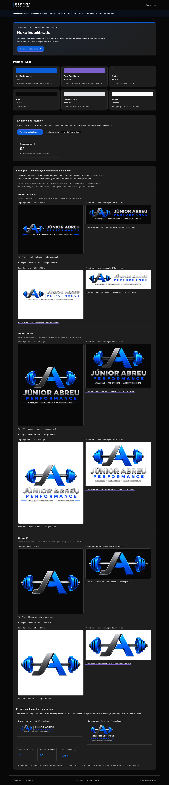
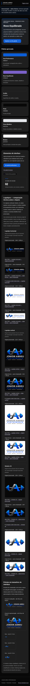
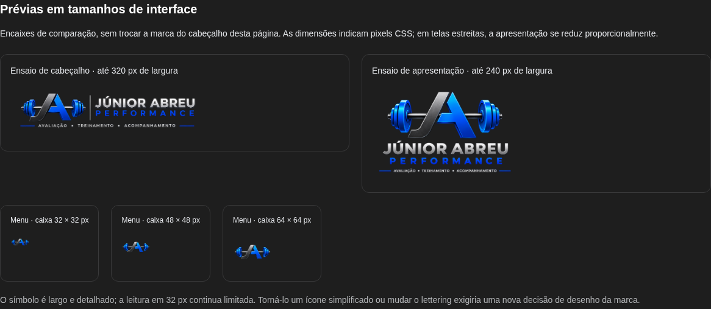

# Revisão visual — Roxo Equilibrado

Proposta incorporada à Etapa 165. A paleta está aprovada; os painéis permanecem em revisão, sem deploy ou aprovação definitiva. Todas as capturas usam dados fictícios. Não há contas, sessões ou dados do Supabase nas imagens.

Acesse `/demonstracao/identidade` ao executar a branch para revisar amostras das seis cores, ações e indicadores. Os três painéis estão ligados à mesma fonte de tokens em `src/components/demonstracao/tokens.ts`, com CSS limitado ao escopo `.ja-demo` em `theme.css`. Autenticação e páginas fora da demonstração não foram recoloridas.

## Aplicação

- Azul Performance `#0B5ED7` nas ações e navegação selecionada.
- Roxo Equilibrado `#7B61C9` em detalhes pequenos: pontos de indicadores, bordas de ações, sublinhados e transição dos filetes.
- Grafite `#1E1E1E`, Preto `#080808`, Cinza Metálico `#E5E7EB` e Branco `#FFFFFF` compõem superfícies e texto.
- Sem neon, brilho ou grandes áreas roxas. Estados também são identificados por texto.

## Contraste e limites

Pares de referência calculados por luminância relativa sRGB:

| Par | Razão |
|---|---:|
| Branco sobre Azul Performance | 5,84:1 |
| Branco sobre Roxo Equilibrado | 4,78:1 |
| Cinza Metálico sobre Grafite | 13,47:1 |
| Roxo Equilibrado sobre Grafite | 3,49:1 — usado como detalhe não textual |

Não usar azul ou roxo como texto pequeno sobre Grafite: os pares não atendem 4,5:1. Os painéis usam branco/cinza e tom neutro derivado para texto. Foco por teclado recebe contorno branco. Os testes verificam cores efetivas, pares de texto selecionados, indicador roxo e ausência de overflow; não equivalem a auditoria WCAG completa ou teste em aparelhos físicos.

**Cópias técnicas para comparação:** os originais permanecem intactos. O [relatório de refinamento](brand/REFINAMENTO.md) documenta ajuste de margens e remoção conservadora de componentes isolados de alfa 1, com RGB e pixels da marca preservados. `/demonstracao/identidade` compara antes/depois em fundos escuro/claro e inclui ensaios de cabeçalho/menu. Nenhum arquivo novo foi ativado nos painéis.

## Administrador — desktop, 1440 px

## Profissional — desktop, 1440 px

## Aluno — viewport de celular, 390 px

## Logotipos — galeria técnica, sem ativação nos painéis

## Refinamento autorizado — antes/depois

