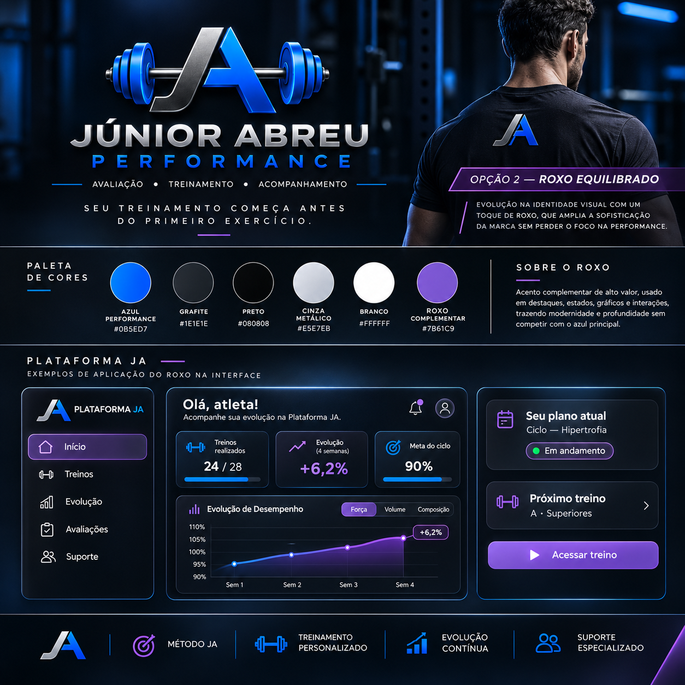

# Inspeção inicial dos PNGs enviados — histórico

Fonte: arquivo `Downloads.rar` enviado pelo proprietário. O pacote contém três logotipos PNG RGBA e uma prancha PNG RGB. Nenhum conteúdo da prancha foi interpretado como instrução de execução ou como funcionalidade já implementada.

Os arquivos foram extraídos e copiados sem qualquer processamento da imagem. Nomes foram normalizados para URLs; SHA-256, nomes originais e dimensões estão em [manifest.json](manifest.json). O original de referência está em [prancha-referencia.png](prancha-referencia.png), exclusivamente para comparação no PR, fora dos assets públicos da demonstração.

## Resultados de leitura dos pixels

| Versão | Dimensões | Pixels totalmente transparentes | Região com alfa > 16 (x0,y0,x1,y1) |
|---|---|---:|---|
| Horizontal | 1448 × 1086 | 87,95% | (96,420,1363,676) |
| Vertical | 1122 × 1402 | 78,38% | (53,393,1070,1029) |
| Símbolo | 1254 × 1254 | 82,29% | (55,430,1197,872) |

- Os três têm canal alfa com valores entre 0 e 255. O fundo não é um retângulo preto opaco: as prévias no chat o apresentavam sobre preto.
- Há pixels de baixa opacidade fora dessas regiões: horizontal 3.695 (alfa máximo 16); vertical 2.062 (máximo 9); símbolo 6.117 (máximo 8). Isso explica por que simplesmente usar a caixa de todos os pixels não transparentes não resolve as margens.
- O limiar 16 é somente diagnóstico; não define um recorte autorizado e pode excluir sombras legítimas. Não foi aplicado ao arquivo.
- As grandes margens superior/inferior ocupam boa parte de cada tela. Reduzir o arquivo completo para um cabeçalho/ícone deixa a marca e a assinatura pequenas. Esticar, cortar ou ampliar além da resolução nativa não é solução silenciosa aceitável.
- A inspeção visual mostra bordas claras/cianas, serrilhado/irregularidades em detalhes e diferenças de espessura/acabamento do lettering frente à prancha. É preciso confirmar se esses tratamentos são intencionais. A composição horizontal foi aprovada como variante; sua disposição diferente da versão vertical não é tratada como erro.
- As cores metálicas e múltiplos tons de azul da arte não foram convertidos para os tokens da interface. A paleta do produto continua Azul Performance/Roxo Equilibrado; a marca não foi recolorida para forçar correspondência.
- A resolução do canvas é suficiente para exibição moderada, mas não comprova nitidez vetorial nem boa leitura da assinatura em tamanhos pequenos. Não há arquivo vetorial/matriz editável para certificar equivalência geométrica exata.

## O que está disponível para aprovação

`/demonstracao/identidade` mostra os três PNGs integrais em fundo escuro e oferece inspeção em fundo claro, além de links para os originais. Usa `next/image` com `unoptimized`, proporção preservada e textos alternativos. Não há filtro, recorte, remoção de fundo ou recompressão. As imagens públicas estão em `public/brand/propostas/`, claramente como propostas para revisão, não como marca já homologada.

A ativação em cabeçalhos, menus compactos e apresentação **permanece pendente**, conforme a instrução do proprietário de apresentar divergências antes da incorporação definitiva. Os painéis continuam com identificação textual, sem substituição silenciosa. Nada foi aplicado às telas reais de autenticação ou ao favicon.

Na inspeção inicial não foi executado recorte ou limpeza. Depois, o proprietário autorizou cópias técnicas exclusivamente para comparação. Ver [refinamento autorizado, operações e antes/depois](REFINAMENTO.md). Os originais e os achados desta inspeção permanecem preservados; ativação nos painéis, recoloração e redesenho não estão autorizados.

## Prancha de comparação

A prancha é material visual fornecido pelo proprietário. Os gráficos, métricas, pessoa retratada e telas nela presentes não são dados de alunos nem funcionalidades implementadas pela Plataforma JA nesta entrega.

## Verificações realizadas nesta revisão

- 18 testes unitários existentes de autenticação e 4 testes de arquivos aprovados.
- Build de produção aprovado usando configuração fictícia loopback.
- Lint sem erros; permanece o aviso preexistente de import não usado em `/teste-supabase`.
- 199 assertivas Chromium locais: navegação/proteção anteriores preservadas, viewport 1440/390/320, imagens carregadas, proporção nativa, alt, fundo claro e hashes dos bytes servidos.
- Capturas da galeria em [desktop](../previews/identidade-logotipos-desktop.png) e [viewport de celular](../previews/identidade-logotipos-celular.png), com as opções de fundo claro abertas para inspeção. Não representam uso da marca já homologado.
